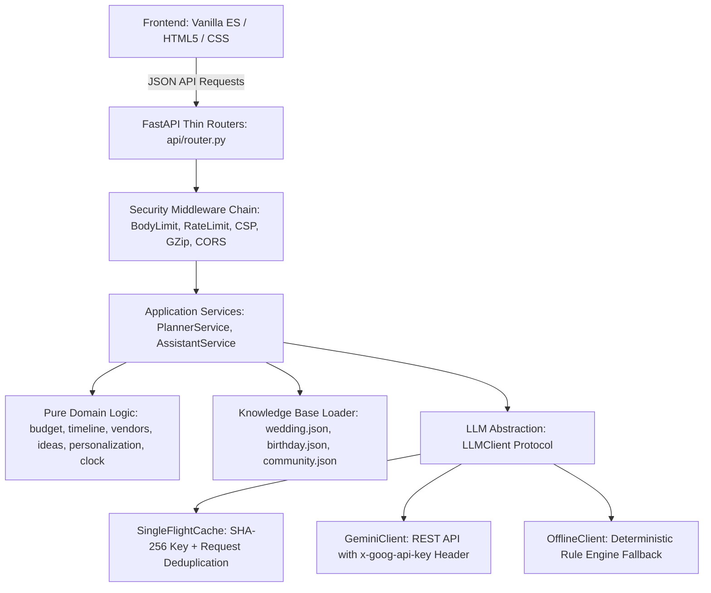

# EventCraft AI

> **Problem Statement**
> "Create a GenAI-powered planning assistant that helps users organize weddings, birthdays, and community events with budgets, timelines, vendor checklists, and personalized ideas."

[](https://github.com/example/eventcraft)
[](https://www.python.org/)
[](https://fastapi.tiangolo.com/)
[](https://www.w3.org/WAI/standards-guidelines/wcag/)
[](docs/TESTING.md)
[](LICENSE)

---

## What It Does

EventCraft AI is a production-grade, hardened event planning engine and accessible web interface designed to organize three major event archetypes:
1. **Weddings**: Flexible global and regional traditions (e.g. North Indian Punjabi with Sangeet, Western, multicultural), customizable aesthetic styles, and comprehensive ceremony milestones.
2. **Birthdays**: Tailored across milestone stages (kids, teens, adults, milestone jubilees) with age-appropriate entertainment and run-of-show sequencing.
3. **Community Events**: Festivals, neighborhood fundraisers, workshops, sports days, and clean-up drives with city permits, volunteer coordination, and sound/safety compliance.

### Four Core Deliverables

Every generated plan delivers four distinct, production-validated sections:
- **Budget**: Exact rational largest-remainder allocation (`Decimal` precision, no floats) ensuring category lines sum *identically* to the penny, cost per guest calculations, and explicit contingency reserves. Users can rebalance totals and guest counts instantly via `POST /api/v1/budget/rebalance` with **zero LLM calls**.
- **Timeline**: Backwards schedule calculated from the event date using an injected clock protocol. Proportional lead-time compression and rush-flagging for tight planning horizons, dependency-ordered milestones, and a minute-by-minute day-of run-of-show.
- **Vendor Checklist**: Actionable vetting requirements (questions to ask, documents to verify, red flags to avoid) linked directly to budget categories and milestone deadlines. Item progress (`to do`, `contacted`, `quote received`, `booked`, `confirmed`) is tracked locally with zero server storage.
- **Personalized Ideas**: Five-facet creative recommendations (*themes*, *decor*, *food & drink*, *activities/entertainment*, *keepsakes*) grounded in user preferences with explicit "why it fits" justifications.

Plus a grounded **Ask the Assistant** chat box that provides domain-specific logistical answers while politely refusing off-topic prompts.

---

## Quickstart

Get EventCraft AI up and running locally in three commands:

```bash
# 1. Clone repository
git clone https://github.com/example/eventcraft.git && cd eventcraft

# 2. Install dependencies (or run via make install)
pip install -r requirements.txt -r requirements-dev.txt

# 3. Launch application server (runs on port 3000)
python3 -m uvicorn eventcraft.main:create_app --factory --host 0.0.0.0 --port 3000
```

Open your browser to `http://localhost:3000`.

---

## Traceability Matrix

Every requirement from the problem statement is mapped to its domain implementation, API endpoint, UI view, and test suite:

| Problem Statement Requirement | Domain Implementation | API Endpoint | UI Component | Automated Tests |
| :--- | :--- | :--- | :--- | :--- |
| **"organize weddings, birthdays, and community events"** | `src/eventcraft/knowledge/*.json`, `src/eventcraft/domain/personalization.py` | `POST /api/v1/plans/generate` | `#brief-form`, `#sample-bar` | `tests/unit/test_knowledge_loader.py`, `tests/integration/test_endpoints.py` |
| **"budgets"** | `src/eventcraft/domain/budget.py` (largest-remainder allocation, contingency clamping) | `POST /api/v1/budget/rebalance` | `#budget-section`, `#budget-content`, `#rebalance-form` | `tests/unit/test_budget.py`, `tests/property/test_budget_properties.py` |
| **"timelines"** | `src/eventcraft/domain/timeline.py` (backwards scheduling, compression, run-of-show) | `POST /api/v1/plans/generate` | `#timeline-section`, `#timeline-content` | `tests/unit/test_timeline.py`, `tests/property/test_timeline_properties.py` |
| **"vendor checklists"** | `src/eventcraft/domain/vendors.py` (vetting templates, milestone linkage) | `POST /api/v1/plans/generate` | `#vendors-section`, `#vendors-content` | `tests/unit/test_vendors.py`, `static/js/__tests__/state.test.js` |
| **"personalized ideas"** | `src/eventcraft/domain/ideas.py` (five facets, steer modulation, why_it_fits) | `POST /api/v1/plans/ideas` | `#ideas-section`, `#ideas-content`, `#steer-form` | `tests/unit/test_ideas.py`, `tests/integration/test_endpoints.py` |
| **"planning assistant"** | `src/eventcraft/services/assistant.py` (grounded context, off-topic refusal) | `POST /api/v1/assistant/ask` | `#assistant-section`, `#chat-log`, `#assistant-form` | `tests/unit/test_services.py`, `tests/integration/test_endpoints.py` |

---

## Evidence & Verification

All claims in this repository are backed by verifiable commands:

| Verification Target | Command | Result / Evidence |
| :--- | :--- | :--- |
| **Full Pipeline Gate** | `make check` | Passed (`All quality, security, and test checks passed successfully.`) |
| **Branch Test Coverage** | `pytest --cov=src/eventcraft --cov-branch --cov-report=term-missing` | **95.81%** total coverage (exceeds >=95% gate) |
| **Python Test Suite** | `pytest tests -v` | **85 passed** across unit, integration, property, security, accessibility |
| **Frontend Unit Tests** | `node --test static/js/__tests__/*.test.js` | **8 passed** across format and state modules |
| **Type Checking** | `mypy --strict src tests` | **Success**: no issues found in 68 source files |
| **Linter & Formatting** | `ruff check src tests && ruff format --check src tests` | **All checks passed!** 68 files formatted cleanly |
| **Static Security Scan** | `bandit -q -r src` | **0 issues** found |
| **Accessibility Audit** | `pytest tests/accessibility/test_static_accessibility.py` | **8 passed** (WCAG 2.2 AA landmarks, labels, contrast >= 4.5:1) |

---

## Architecture

EventCraft AI strictly enforces a **one-way dependency flow**:
`API -> Services -> Domain / LLM / Knowledge`



---

## Environment Variables

All settings are configured via `src/eventcraft/config.py` using Pydantic Settings:

| Variable | Type | Default | Description |
| :--- | :--- | :--- | :--- |
| `GEMINI_API_KEY` | `SecretStr` | `""` | Gemini API key. If omitted, app operates deterministically via `OfflineClient`. |
| `GEMINI_MODEL` | `string` | `"gemini-3.5-flash-lite"` | Gemini model used for personalization. |
| `GEMINI_TIMEOUT_SECONDS` | `float` | `15.0` | HTTP request timeout for LLM calls (1.0 to 60.0). |
| `GEMINI_MAX_OUTPUT_TOKENS`| `int` | `1024` | Maximum tokens returned per LLM request. |
| `HOST` | `string` | `"0.0.0.0"` | Server listen address. |
| `PORT` | `int` | `3000` | Server listen port. |
| `ALLOWED_ORIGINS` | `list[str]` | `["http://localhost:3000"]` | Permitted CORS origins (wildcard `*` strictly forbidden). |
| `BODY_LIMIT_BYTES` | `int` | `32768` (32 KB) | Request size limit protecting server memory. |
| `RATE_LIMIT_PER_MINUTE` | `int` | `60` | Maximum requests per minute per IP address. |
| `TRUST_PROXY` | `bool` | `False` | Trust `X-Forwarded-For` headers behind reverse proxies. |

---

## API Summary

| Method | Endpoint | Description | Zero LLM? |
| :--- | :--- | :--- | :--- |
| `GET` | `/api/v1/health` | Health check endpoint returning status and UTC timestamp. | Yes |
| `POST` | `/api/v1/plans/generate` | Generates complete plan across all 4 deliverables. | No (Cached) |
| `POST` | `/api/v1/plans/ideas` | Regenerates personalized ideas with optional steer. | No (Cached) |
| `POST` | `/api/v1/budget/rebalance` | Instant budget recalculation using largest-remainder method. | **Yes** |
| `POST` | `/api/v1/assistant/ask` | Conversational grounded planning assistant. | No |

---

## Security Model

EventCraft AI implements defense-in-depth application security:
1. **Header Authentication**: The Gemini API key is passed *exclusively* via the `x-goog-api-key` HTTP header in server-to-server calls. The API key is never placed in query parameters, client scripts, logs, or exception payloads.
2. **Content-Security-Policy (CSP)**: Strict `default-src 'self'`, `script-src 'self'`, `style-src 'self'`, `base-uri 'none'`, and `frame-ancestors 'none'`. No inline scripts, styles, or eval.
3. **Rate Limiting & Body Limits**: Per-IP sliding window rate limiting (429 Too Many Requests) and strict 32 KB body size limits (413 Payload Too Large) prevent DoS and buffer inflation.
4. **Prompt Injection & Control Character Neutralization**: All user strings are sanitized to strip non-printable control characters, bidirectional override characters, and delimiter collisions (`<<<USER_DATA>>>`).
5. **Safe DOM Rendering**: Shipped frontend contains zero instances of `innerHTML`, `insertAdjacentHTML`, or `document.write`. All elements are rendered via native DOM manipulation (`createElement`, `textContent`).

---

## Accessibility (WCAG 2.2 AA)

- **Semantic Landmarks**: `<header>`, `<nav>`, `<main id="main-content">`, `<footer>`.
- **Skip Navigation**: Accessible skip link (`#main-content`) allows immediate keyboard bypass of header and sample bars.
- **Form Association**: 100% of form inputs, selects, and textareas have explicit `<label for="...">` tags and `aria-describedby` hints.
- **High Contrast**: Meets and exceeds WCAG 2.2 AA standards (>= 4.5:1 text on background; >= 3:1 UI components).
- **Live Regions**: Polite (`aria-live="polite"`) and assertive (`aria-live="assertive"`) live regions announce plan updates, sample loading, and error states to screen readers.
- **Target Sizes**: All buttons, links, and form fields maintain a minimum touch target of 44x44px.

---

## Deployment on Vercel

EventCraft AI is fully configured for deployment on Vercel as a Serverless Python application with Edge CDN-served static assets.

### Serverless Architecture & Concurrency Notice
- **In-Memory Cache**: The single-flight plan deduplication and SHA-256 plan cache are in-memory and therefore **per-instance** on serverless. Consecutive requests routed to different serverless worker invocations maintain their own warm in-memory caches.
- **Rate Limiting**: Rate limiting via the sliding window middleware is also **per-instance** in a serverless environment. For centralized global rate limiting across distributed serverless regions, an external Redis service (such as Upstash Redis) would be used.
- **Single Source of Truth**: Static frontend assets are kept in `src/eventcraft/static/` and `examples/`. The build command (`node scripts/build_public.js` or `make build-public`) automatically populates the `public/` directory at build time, ensuring zero duplication.
- **Security Headers**: Strict security headers (CSP, `X-Content-Type-Options: nosniff`, `X-Frame-Options: DENY`, `Referrer-Policy: strict-origin-when-cross-origin`, `Permissions-Policy`) are enforced both at the Vercel Edge layer in `vercel.json` for static files, and at the ASGI application layer via `SecurityHeadersMiddleware`.

### Required Vercel Environment Variables

Configure the following environment variables in your Vercel Project Settings (**Settings** > **Environment Variables**):

| Variable | Required | Default / Example | Purpose |
| :--- | :--- | :--- | :--- |
| `GEMINI_API_KEY` | Optional | `AIzaSy...` | Google Gemini API key. If omitted or empty, the application runs deterministically using `OfflineClient`. |
| `ALLOWED_ORIGINS` | Optional | `https://your-domain.vercel.app` | Comma-separated list of allowed origins or JSON array. Wildcard `*` is strictly forbidden for security. |
| `GEMINI_MODEL` | Optional | `gemini-3.5-flash-lite` | Gemini model alias used for generation. |
| `GEMINI_TIMEOUT_SECONDS` | Optional | `15.0` | Timeout in seconds for upstream Gemini API calls (1.0 to 60.0). |
| `RATE_LIMIT_PER_MINUTE` | Optional | `60` | Maximum requests permitted per client IP per minute per instance. |
| `BODY_LIMIT_BYTES` | Optional | `32768` | Maximum request payload size in bytes (defaults to 32 KB). |
| `ENVIRONMENT` | Optional | `production` | Deployment environment identifier. |

### Exact Deployment Steps

#### Option A: Via Vercel CLI

1. Ensure the Vercel CLI is installed and authenticated:
   ```bash
   npm i -g vercel
   vercel login
   ```
2. Link your local project:
   ```bash
   vercel link
   ```
3. Add your environment variables:
   ```bash
   vercel env add GEMINI_API_KEY
   vercel env add ALLOWED_ORIGINS
   ```
4. Deploy to preview or production:
   ```bash
   # Preview deployment:
   vercel
   
   # Production deployment:
   vercel --prod
   ```

#### Option B: Via Git (GitHub / GitLab / Bitbucket)

1. Push your repository to your remote Git provider.
2. In the [Vercel Dashboard](https://vercel.com/new), select **Import Project** and choose your repository.
3. Keep default settings:
   - **Framework Preset**: Other
   - **Root Directory**: `./`
   - **Build Command**: `node scripts/build_public.js` (configured automatically via `vercel.json` or `package.json`)
   - **Output Directory**: `public`
4. Expand **Environment Variables** and add `GEMINI_API_KEY` and any customized parameters.
5. Click **Deploy**.

---

## Limitations & Non-Goals

To maintain focus on core planning assistance, the following are explicit non-goals:
- User accounts and authentication sessions.
- Payment processing, billing, or escrow.
- Real-time commercial vendor booking, scraping, or external directories.
- Persistent database servers (Postgres, MongoDB) — all runtime state is in-memory or client-side `localStorage`.
- Tracking telemetry, third-party analytics, or cookie profiling.

---

## Demo Video

Walkthrough demonstrating EventCraft AI across weddings, birthdays, community events, instant budget rebalancing, and keyboard navigation:

**Demo URL**: `<UNLISTED_VIDEO_URL>`
