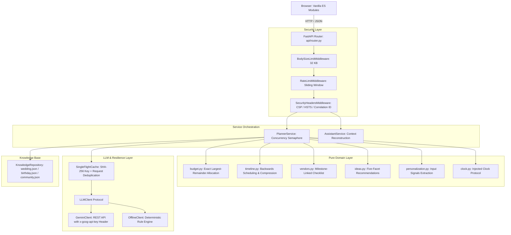

# Architecture & Design

EventCraft AI is engineered around clean domain-driven architecture and strict one-way dependencies. Business rules and algorithmic calculations remain decoupled from external I/O, network frameworks, and UI rendering.

---

## One-Way Dependency Rule

The dependency hierarchy strictly flows in a single direction:

```
api (Routers) -> services (Orchestration) -> domain (Pure Logic) / llm / knowledge
```

- **api/**: Contains lightweight FastAPI route handlers. No business math, scheduling rules, or LLM prompt formatting lives in the router layer.
- **services/**: Coordinates domain logic with asynchronous I/O (Gemini API calls, in-memory caching, concurrency semaphores).
- **domain/**: Pure Python functions and immutable dataclasses with zero imports from `fastapi`, `httpx`, or external web packages. Can be tested without any network or server mock overhead.
- **knowledge/**: Startup-validated JSON templates defining verified base structures for weddings, birthdays, and community events.
- **llm/**: Protocol-driven client layer with caching, guardrails, and deterministic fallbacks.

---

## Architecture Diagram



---

## Key Algorithmic Designs

### 1. Largest-Remainder Budget Allocation (`domain/budget.py`)

Financial allocations must never suffer from floating-point rounding errors or lost cents. EventCraft AI computes exact category shares using rational `Fraction` arithmetic:
1. Clamps user and template weights within strict boundaries (`min_share` and `max_share`).
2. Reserves a user-configured contingency buffer (3.00% to 15.00%, default 5.00%).
3. Multiplies the remaining total by each normalized fraction and extracts the integer cent portion (`floor`).
4. Calculates the remaining unallocated cents ($R = Total - \sum Cents$).
5. Distributes remaining cents one-by-one to categories with the largest fractional remainders.
6. Guarantees that $\sum \text{category amounts} + \text{contingency} = \text{total budget}$ *identically to the penny*.

### 2. Proportional Backwards Timeline Scheduling (`domain/timeline.py`)

Timelines are computed backwards from the event date to prevent scheduling events in the past:
1. Calculates available planning horizon ($L = \text{Event Date} - \text{Reference Date}$).
2. Rejects dates in the past ($L < 0$) or beyond 3 years horizon ($L > 1095$).
3. Compares $L$ to the ideal lead time ($L_{ideal}$).
4. If $L < L_{ideal}$, compresses milestone gaps proportionally:
   $$\text{lead\_days}_{compressed} = \min(L, \max(0, \text{round}(L \times \frac{\text{lead\_days}_{ideal}}{L_{ideal}})))$$
5. Flags milestones as `is_rush = True` if compressed significantly below standard lead requirements.
6. Enforces topological dependency ordering so dependent tasks never precede prerequisites.

### 3. Single-Flight LLM Cache (`llm/cache.py`)

To prevent duplicate LLM calls during simultaneous user requests:
- Generates deterministic SHA-256 keys from normalized request parameters.
- Uses `asyncio.Future` single-flight locks: if multiple identical requests arrive while an LLM call is in-flight, subsequent requests await the single pending future instead of firing redundant HTTP requests.
- Maintains in-memory LRU eviction with configurable TTL (default 1 hour) and maximum size.

### 4. Zero-Network Fallback (`llm/offline.py`)

When no Gemini API key is configured or when network calls exceed timeouts:
- The system seamlessly fails over to `OfflineClient`.
- Pure deterministic template engines derive customized weights, wording, and five-facet ideas directly from extracted user signals.
- Transparently labels responses with `meta.source = "template"`, ensuring full functional continuity without crashing.
